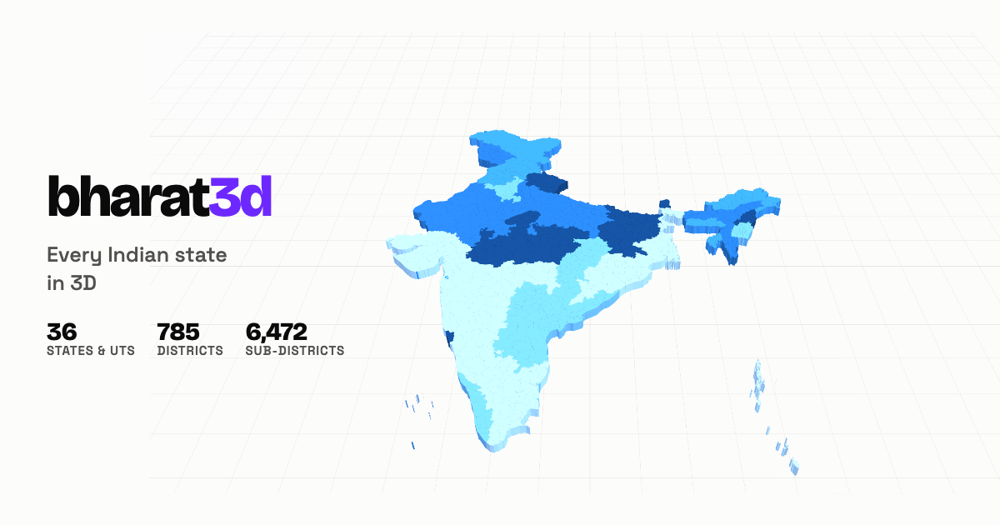

# @bharat3d/state-maps

[](https://github.com/sahilgumber7/bharat-3d/actions/workflows/ci.yml)
[](https://www.npmjs.com/package/@bharat3d/state-maps)
[](../../LICENSE)
[](#install)

3D maps of **every Indian state and union territory** for Three.js — 28 states + 8 UTs, 785 districts, six camera presets, themeable toolbar.

**[Open the live demo →](https://bharat3d.vercel.app)**

[](https://bharat3d.vercel.app)

Give it a container and a state slug. That's the whole integration.

```js
import { createStateMap } from '@bharat3d/state-maps';
import { loadStateData } from '@bharat3d/state-maps/data';

const map = await createStateMap({
  container: '#map',
  state: 'bihar',
  load: loadStateData,
});
```

It builds the renderer, scene, camera, lights, render loop and resize handling, and mounts a toolbar with six views: **isometric**, **cross-section** (a real clipping plane), **2D top-down**, **front elevation**, **first-person walkthrough**, and **exploded districts**.

Want the whole country instead of one state — a clickable national picker? Same shape, [`createIndiaMap`](#createindiamapoptions--promiseindiamaphandle):

```js
import { createIndiaMap, createStateMap } from '@bharat3d/state-maps';
import { STATES, loadStateData } from '@bharat3d/state-maps/data';

const india = await createIndiaMap({
  container: '#map',
  registry: STATES,
  load: loadStateData,
  onSelect: async (slug) => {
    india.destroy();
    await createStateMap({ container: '#map', state: slug, load: loadStateData });
  },
});
```

Already have a Three.js scene? Skip `createStateMap`/`createIndiaMap` and use [`buildStateMap`/`buildIndiaMap` + `MapViewController`](#already-have-a-scene) against your own objects.

---

## Try it without installing anything

```bash
npx @bharat3d/state-maps list             # all 36 states/UTs and their slugs
npx @bharat3d/state-maps preview kerala   # live map on localhost
npx @bharat3d/state-maps add tamil-nadu   # scaffold a runnable starter
```

`add` writes a project you can run immediately:

```bash
npx @bharat3d/state-maps add kerala
cd kerala-map && npx serve .              # no install — CDN import map

npx @bharat3d/state-maps add kerala --framework react
cd kerala-map && npm install && npm run dev
```

## Install

```bash
npm install @bharat3d/state-maps three
```

`three` is a peer dependency (>= 0.128, tested through 0.16x). `react` is optional, only for the `/react` wrapper. No runtime dependencies.

---

## API

### `createStateMap(options) => Promise<StateMapHandle>`

| Option | Default | |
| --- | --- | --- |
| `container` | — | **Required.** Element or selector. It gets the canvas, so give it a size. |
| `state` + `load` | — | Slug plus a loader. Use `loadStateData` from `/data`. |
| `data` | — | A state document directly — use instead of `state`/`load` to control bundling. |
| `palette` | `'midnight'` | `midnight` · `paper` · `ember` · `aqua` |
| `view` | `'isometric'` | Starting preset |
| `span` | `240` | World size of the state's longest axis |
| `thickness` | `4.5` | Tile depth. Raise it and districts read as blocks, not pieces. |
| `relief` | `0.35` | How far district area swings thickness either side of `thickness` |
| `gap` | `0.01` | Seam between neighbouring districts. `0` = flush. |
| `background` | `true` | `false` gives a transparent canvas to composite over |
| `grid` | `true` | Ground grid |
| `toolbar` | `true` | `false` = headless; drive it from your own UI |
| `position` | `'bottom-right'` | Toolbar corner, or explicit CSS offsets |
| `onViewChange` | — | `(viewId) => void` |

The handle:

```js
await map.setView('exploded');       // resolves when the transition lands
map.setPalette('paper');             // scene, lights, grid, toolbar and fills
await map.setState('kerala');        // swap state, reuse scene and camera
map.getView(); map.state; map.districts; map.palette;
map.scene; map.camera; map.renderer; map.controller;  // escape hatches
map.destroy();                       // removes canvas, listeners, GPU resources
```

### Views

`isometric` · `crossSection` · `topDown` · `frontElevation` · `firstPerson` · `exploded`

Presets derive from each state's bounding box, so nothing is hand-tuned per state — the same code frames Delhi and Rajasthan correctly.

### `createIndiaMap(options) => Promise<IndiaMapHandle>`

Every state and UT, reprojected onto one shared real-geography canvas and merged into one coloured mesh per state — a clickable national picker, themeable and camera-driven exactly like `createStateMap`.

| Option | Default | |
| --- | --- | --- |
| `container` | — | **Required.** Element or selector. |
| `registry` + `load` | — | `STATES` + `loadStateData` from `/data`, to fetch every state on demand. |
| `states` | — | Already-loaded `[{ slug, name, doc }]` — use instead of `registry`/`load` to control bundling. |
| `palette` | `'midnight'` | `midnight` · `paper` · `ember` · `aqua` |
| `view` | `'isometric'` | Starting preset — `isometric` (north-up), `topDown`, `firstPerson`, or `exploded` (states fly apart from the national centroid) |
| `span` | `320` | World size of the map's longest axis |
| `depth` | `8` | Extrusion depth |
| `onSelect` | — | `(slug, state) => void` — fires on click. Nothing happens automatically; swap to `createStateMap` yourself, as above. |
| `onHover` | — | `(slug \| null, state \| null) => void` — only wired up if you pass it |
| `onViewChange`, `background`, `grid`, `toolbar`, `position` | — | Same as `createStateMap` |

The handle is the same shape as `createStateMap`'s: `setView`, `getView`, `setPalette`, `states` (each `{ slug, name, group, mesh }`), `scene`/`camera`/`renderer`/`controller`, `resize`, `destroy`.

### `/data`

```js
import { STATES, loadStateData, loaders, findState } from '@bharat3d/state-maps/data';

STATES;                      // [{ name, slug, districtCount, viewBox }, …]
await loadStateData('goa');  // one state's geometry
```

`loaders` is a static `slug -> () => import(…)` map, so bundlers code-split each state. Nothing is pulled in unless you reference it. You can also import one directly:

```js
import goa from '@bharat3d/state-maps/data/goa.js';
createStateMap({ container: '#map', data: goa });
```

### Already have a scene?

```js
import { buildStateMap, MapViewController } from '@bharat3d/state-maps';
import { loadStateData } from '@bharat3d/state-maps/data';

renderer.localClippingEnabled = true;              // needed by cross-section

const { group, stateConfig, recolor } = buildStateMap(await loadStateData('odisha'));
scene.add(group);

const mvc = new MapViewController(scene, camera, stateConfig, { renderer });
```

`MapViewController` works against *any* geometry, not just this data pack — pass your own `stateConfig` (`{ name, bounds, centroid, districts, viewOverrides }`) and it derives every preset from that. Full surface: [`src/index.d.ts`](src/index.d.ts).

The India-wide equivalent is `buildIndiaMap`:

```js
import { buildIndiaMap } from '@bharat3d/state-maps';
import { STATES, loadStateData } from '@bharat3d/state-maps/data';

const docs = await Promise.all(STATES.map((s) => loadStateData(s.slug)));
const entries = STATES.map((s, i) => ({ slug: s.slug, name: s.name, doc: docs[i] }));

const { group, states, box, recolor } = buildIndiaMap(entries);
scene.add(group);
// states: [{ slug, name, group, mesh }] — mesh.userData.stateSlug for your own raycasting
```

### React

```jsx
useEffect(() => {
  let map, cancelled = false;
  createStateMap({ container: ref.current, state: 'punjab', load: loadStateData })
    .then((m) => (cancelled ? m.destroy() : (map = m)));
  return () => { cancelled = true; map?.destroy(); };
}, []);
```

`npx @bharat3d/state-maps add <slug> --framework react` scaffolds exactly this. There's also `@bharat3d/state-maps/react`, a wrapper for driving `MapViewController` over a scene React already owns.

TypeScript types ship with the package; no `@types` needed.

---

## Colour

Four palettes, each owning the scene surface, lights, grid, toolbar theme and district ramp. Switching never rebuilds geometry.

District fill is a **sequential ramp keyed to district area** — the same variable driving extrusion height, so colour and relief reinforce rather than compete. Deliberately not categorical: a categorical palette encodes identity, and none survives 38 mutually adjacent fills (UP has 71). Cycling hues would make colour look meaningful while meaning nothing.

Every ramp passes an ordinal-palette gate — single hue, monotone lightness, adjacent ΔL ≥ 0.06, and the step nearest the surface clearing 2:1 so no district sinks into the background. `npm test` enforces the monotonicity and contrast floors; re-run it if you change a step.

Toolbar colours are separately themeable via `theme` tokens (`accent`, `surface`, `icon`, `radius`, …) — no branding is baked in.

---

## The data

`data/states/` — one ES module per state, ~1.8 MB total, so you only ship what you use.

```js
{
  name: 'Kerala', slug: 'kerala', viewBox: [1000, 1796.7],
  bbox: [74.86304, 8.29136, 77.41269, 12.79508], districtCount: 14,
  districts: [
    { name: 'Alappuzha', path: 'M592.4 1180.7L…Z', centroid: [643.8, 1354.2], parts: 1 }
  ]
}
```

Each district is an SVG path in a per-state pixel space 1000 units wide. `parts > 1` means islands — one `M…Z` subpath per part (Gujarat has 9 such districts, Andaman & Nicobar all 3).

### Caveats — read before shipping

Boundaries come from [bharatlas.com](https://bharatlas.com)'s Local Government Directory (LGD) district snapshot, 2024 — 785 districts across all 36 states/UTs, including Telangana and Ladakh. It's CC0-1.0 / CC-BY-4.0.

- **Very recent reorganisations may lag.** Ladakh's April 2026 split into five districts (Zanskar, Drass, Sham, Nubra, Changthang) postdates this snapshot, so Ladakh still shows as its pre-split 2 districts here.
- Display names are normalised for casing (the source uses ALL CAPS) but **no boundary is altered**.

An older Census-2011 build (DataMeet `maps`, 35 states/UTs, Telangana/Ladakh absent) is still readable via `--src` if you need it for comparison.

### Regenerating

```bash
npm run build:data
npm run build:data -- --src ./newer.geojson --tolerance 0.4
```

[`tools/build-state-data.mjs`](tools/build-state-data.mjs) owns everything under `data/` — don't hand-edit it. It projects each state equirectangularly about its own centre (longitude scaled by `cos(latitude)` to keep the aspect true) and simplifies with Ramer–Douglas–Peucker. Point `--src` at a current boundary file to fix the caveats above.

---

## Development

```bash
npm install
npm test          # data integrity, frustum fitting, palette gates
npm run demo      # gallery of all 36 states/UTs at localhost:5173/examples/india/
```

## Licence

MIT. Boundary data is bharatlas.com's LGD snapshot, CC0-1.0 / CC-BY-4.0.
